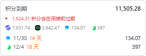

# dsh-credit-expiry

左侧边栏的「积分到期」：底栏一行只放最要紧的信息（四平台余额 + 最近到期日），点进去是完整页面（到期分布 + 积分消耗 + 积分会话）。

## 数据来源

宿主半（`lib/index.js`）在 DSH Web 服务上注册同源路由 `GET /credit-expiry/api/data`，一次返回五份数据：

| 字段 | 来源 | 说明 |
| --- | --- | --- |
| `wb` | `/plugins/dsh-connect-workbuddy/usage` | WorkBuddy 积分包（含到期毫秒时间戳） |
| `tr` | `/plugins/dsh-connect-trae/usage` | Trae 积分账户（含到期毫秒时间戳） |
| `mm` | `/plugins/dsh-connect-minimaxcode/status` | MiniMax Code 积分（`credits.upcoming` → `lots`） |
| `qd` | `/plugins/dsh-connect-qoder/usage` | Qoder 积分包（到期日取套餐到期时间） |
| `usage` | `~/.dsh/storages/cost-meter/ledger.json` | 近 14 天积分消耗（含 `byPool` 分平台）、按模型汇总、最近 24 条积分会话 |

任一上游失败都不影响其余，失败项写进 `errors`，客户端照常渲染成功的一侧。账本按 `ino:mtime:size` 缓存，1.4MB 的单行 JSON 不会每次重解析。

**只统计积分池**：`CREDIT_PROVIDERS = ['workbuddy', 'trae', 'minimaxcode', 'qoder']`，`PROVIDER_POOL` 把它们映射到 `wb / tr / mm / qd` 四个池。DeepSeek 直连、CLI Proxy、魔搭这些走现金的 provider 一律排除——它们不消耗任何会过期的余额，混进来只会淹没积分口径。

**Qoder 的到期日是套餐日**：它返回的 `credits.packages` 只有 `base` / `addon` 两个包，各自没有到期时间，只有 `credits.planExpiresAtMs`。套餐失效后余额一并消失，所以每个包都套用套餐日，而不是多开一个「永不过期」的桶。

## 积分与人民币

界面以**积分**为主显示，人民币只作为官网价的参考注释（`≈¥`）。

换算用单一常量 `CREDIT_CNY = 0.15`（1 积分 ≈ ¥0.15），依据是 2026-11-16 两平台的实测比值：

- WorkBuddy：266.31 积分 ↔ 名义 ¥40.90 → 6.51 积分/元
- Trae：164.73 积分 ↔ 名义 ¥25.61 → 6.43 积分/元

两个模型构成完全不同的平台落在同一个比例上，说明这是定价而非巧合。宿主半把它放进 `usage.creditCny` 一并下发，客户端读不到时回落到同一默认值。

## 界面

### 侧边栏底栏（compact）



顶部一行是四平台官方图标 + 余额图例，下面每行一个最近到期的项目：到期平台的图标 + 日期 + 剩余天数 + 积分。点整块打开完整页面。

### 完整页面


整页 `height:100%; overflow-y:auto` 独立滚动，不会把外层容器撑高。自上而下：

1. 标题栏：返回会话、标题、更新时间、刷新。
2. 合计卡：剩余积分总计 + 按平台的堆叠条 + 带图标的图例。
3. 提醒条：30 天内到期的到期日数量与积分合计；没有临期时显示绿色常态。
4. 按平台：四张卡 2×2 排列，各含平台图标与名称、平台总量、内部紧迫度堆叠条、最近 3 个到期日（同日多项合并成「N 项」）。点卡片可按平台筛选。
5. 按到期日：每天一行，左侧是到期平台的官方图标，**条形长度 = 该行积分 / 当前显示行的最大积分**，所以 200 积分明显比 100 积分长，而不是每行都拉满；默认 8 行，可展开全部。
6. 积分消耗 · 近 14 天：柱状图按平台分色堆叠（柱高按积分，带最高日与日均两条参考线）+ 按 `provider:model` 的消耗排行，右侧积分大、人民币小。
7. 积分会话：时间、平台图标、标题、次数、tokens、积分（下方小字 ≈¥）。
8. 页脚：数据来源与换算口径说明。

## 配色

两套颜色正交，互不干扰：

| 平台 | 主色 | 深色描边 | 品牌图标 |
| --- | --- | --- | --- |
| WorkBuddy（CodeBuddy） | `#6C4DFF` | `#5B3EE8` | 紫色圆角方形双斜条 |
| Trae | `#12B76A` | `#0B8A55` | 黑底绿框双菱形 |
| MiniMax Code | `#00A8F0` | `#0A7DB4` | 蓝色四足小怪兽 |
| Qoder | `#84CC16` | `#4D7C0F` | 白绿官方标志（mintlify 版） |

平台色取自各平台官方 logo 的主色，硬编码不跟皮肤——这样一眼就能分辨"这条是哪家的积分"。Trae 与 Qoder 品牌都是绿色，所以 Trae 取偏冷的 emerald `#12B76A`，Qoder 取偏暖的 lime `#84CC16`，11px 下也能分开。Qoder 用的是官网文档站（qoder.mintlify.app）那张白绿标志，抠掉黑底、保留原始 alpha 后缩到 48×48。

紧迫度色**不跟皮肤**，全部硬编码并把色相拉开：

| 档位 | 色值 | 说明 |
| --- | --- | --- |
| ≤7 天 | `#E5484D` | 红 |
| ≤30 天 | `#F97316` | 橙红 |
| ≤90 天 | `#FACC15` | 亮黄 |
| 90 天以上 | `#94A3B8` | 中性石板灰 |
| 长期有效 | `label-tertiary` | 跟随皮肤 |

90 天以上从绿改成灰，是因为 Trae 和 Qoder 已经占了绿色，紧迫度再绿会和平台色混淆；灰同时也表达"不急"。

图标是 48×48 透明底 PNG 内联成 base64（`ICON` 常量），不发起网络请求，离线也能显示。缺图标时回落成平台色圆点。

## 主题适配

文字、边框、背景、状态色全部走 DSH 设计令牌（`--dsw-alias-label-primary/secondary/tertiary`、`--dsw-alias-border-l1|l2`、`--dsw-alias-bg-layer-1|l2`、`--dsw-alias-brand-primary`、`--dsw-alias-state-error/warn/success-primary`），跟随皮肤自动换色。只有平台身份色与图标是固定的。

## 注册位置

- 底栏行：槽位 `sidebar.footer.action`，id `credit-expiry-mini`，order 2（与 cost-meter 的额度卡片同区）。
- 完整页：槽位 `main`，key `credit-expiry`，`inject` 提供 `surface: 'page'` 与 `backToConversation`。
- 客户端 `inject = ['slots']`；所有注册都包在 `ctx.effect` 里，单点失败只打日志，不影响另一个。

## 与 cost-meter 的关系

侧边栏底部的"费用"卡片由 dsh-cost-meter 绘制，本插件不接管它。各平台积分是通过 cost-meter 的 `config.customBalances` 接入的，现有四条：

| label | request.url | extract.remaining |
| --- | --- | --- |
| 魔搭魔粒 | `https://modelscope.cn/openapi/v1/magicubes/balance` | `data.available_balance` |
| Trae 通用积分 | `/plugins/dsh-connect-trae/usage` | `credits.generalAvailable` |
| MiniMax Code 积分 | `/plugins/dsh-connect-minimaxcode/status` | `credits.total` |
| Qoder 积分 | `/plugins/dsh-connect-qoder/usage` | `credits.total` |

注意 MiniMax 的 `credits.consumed` 是"上次读取后消耗"而非累计值，`maxBudget` 也拿不到历史总额，所以这条只写 `remaining`，不写 `maxBudget` / `spend`。cost-meter 的 `customBalances` schema 没有 `icon` 字段，费用卡里只能靠 label 文字区分。

## 依赖与降级

本插件不 import 任何 `@deepseek-ai/*` 包，只消费两个服务：宿主侧 `webServer`（注册同源路由）与客户端侧 `slots`（挂底栏行和整页）。所以换机器装的时候不会因为 DSH 内部包版本对不上而炸。

四个数据源全部是**可选**的，缺谁少谁，不互相拖累：

| 缺失情况 | 表现 |
| --- | --- |
| 某个 `dsh-connect-*` 没装或没登录 | 该平台不出现在图例、平台卡和到期列表里，`errors` 里记一条 `WorkBuddy: HTTP 404` 这类原因 |
| 四个都没装 | 页面只剩「用量统计」，合计卡为 0，不报错 |
| 没有 cost-meter 账本 | 消耗区块消失，顶部提示「用量统计暂未加载」 |
| 账本路径不在默认位置 | 依次尝试 `$DSH_HOME/storages/cost-meter/ledger.json` 和 `~/.dsh/storages/cost-meter/ledger.json` |
| 请求没带 host 头且拿不到 `webServer.port` | 上游读取报「无法确定 DSH Web 端口」，前端显示错误态，不静默 |

## 兼容性

`engines.dsh = ">=0.2.2-rc.1 <0.3.0-0"`，在 DSH **0.2.2-rc.3** 上实测可用。

这条范围不是随手写的：DSH 当前版本号带预发布标记，semver 的普通范围（`>=0.2.0`、`^0.2.0`）对 `0.2.2-rc.3` **判为不满足**，插件管理器会在下载前直接拒装（`incompatible-version`）。所以下界必须显式写 `-rc`，上界用 `<0.3.0-0` 把整个 0.3 线挡在外面。

如果确实要在别的运行时上强装，走插件管理器的版本豁免：`dsh plugin --profile <p> allow-version dsh-credit-expiry@0.1.0 --dsh-version <运行时版本> --accept-risk`。

## 发布状态

- 仓库：<https://github.com/526365412/dsh-credit-expiry>（MIT）
- Release：<https://github.com/526365412/dsh-credit-expiry/releases/tag/v0.1.0>，附件 `dsh-credit-expiry-0.1.0.tgz` 是预构建包，装它不用跑构建脚本。
- 精选列表：已向 [awesome-dsh-plugin](https://github.com/awesome-dsh-plugin/awesome-dsh-plugin) 提 PR（条目文件 `data/plugins/526365412__dsh-credit-expiry.yml`，分类 `usage`），合入后 dshmarket 与站点一天内收录。
- npm：**尚未发布**（本机没有 npm 账号）。所以目录里暂时不能走 `npm` 源，安装用下面的 Release 包或整仓源码。

## 自建索引

仓库根目录的 `index.json` 是插件市场索引（format 1），把这一条加进「插件 → 发现 → 索引源」就能在自己的市场里看到本插件：

```
https://cdn.jsdelivr.net/gh/526365412/dsh-credit-expiry@main/index.json
```

备用地址（jsDelivr 不通时用）：`https://raw.githubusercontent.com/526365412/dsh-credit-expiry/main/index.json`。

- 索引由 `scripts/build-index.mjs` 生成，不要手改：它从 `package.json` 取版本号、从最近一次改动 `lib/` 或 `package.json` 的提交取 commit 与时间戳，把 `docs/icon.png` 内嵌成 `data:` 图标（<32 KiB），版本源写成 `git + 精确 commit`，装的时候不依赖 npm。
- 改了代码就重新生成并提交：`npm run build:index`；CI 或本地校验用 `npm run check:index`（索引与当前代码不一致时退出码 1）。
- 本机已经把它写进 `cordis.patch.yml` 的 `plugin-market.config.indexes`，和官方目录、awesome-dsh-plugin 并列。

## 安装

**从 Release 预构建包安装（推荐）**

```sh
dsh plugin --profile desktop add https://github.com/526365412/dsh-credit-expiry/releases/download/v0.1.0/dsh-credit-expiry-0.1.0.tgz
```

**从自建索引安装**

索引源加好后，在「插件 → 发现」里搜「积分到期」直接装，等价于：

```sh
dsh plugin --profile desktop add "git+https://github.com/526365412/dsh-credit-expiry.git#<commit>"
```

**从源码安装**

```sh
dsh plugin --profile desktop add github:526365412/dsh-credit-expiry
```

本插件没有构建步骤（`lib/` 就是产物），源码安装不会触发 pnpm 的构建脚本授权。

**本地开发**

1. 把本目录 junction 链接到 `<profile>/node_modules/dsh-credit-expiry`。
2. `<profile>/package.json` 的 `dependencies` 用 `link:` 指向本目录，`dsh.profile.bundles` 登记包名。
3. 宿主半改动需重启 DSH；只改客户端 bundle 按侧边栏刷新即可。

## 说明

到期时间直接用上游返回的毫秒时间戳，按自然日归并（同一天不同时刻到期的多个包算一个到期日），不在插件里推算。MiniMax 只有 `upcoming` 一个汇总额度，因此显示为单条。
