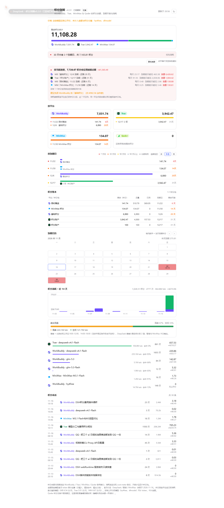

# 积分到期 · dsh-credit-expiry

> DSH 侧边栏里的一块积分看板，帮你看清哪些 AI 平台积分会在用掉之前过期作废。版本：0.9.0。

[](https://github.com/526365412/dsh-credit-expiry/actions/workflows/ci.yml)



## 这插件是干嘛的

先说个真会发生的场景：

你在好几家 AI 平台都有积分——WorkBuddy、Trae、MiniMax Code、Qoder。这些积分不是永久有效的，不少是「这个月不用完就清零」。你平时哪个顺手用哪个，一个月下来，A 家还剩 800 分没动过、昨天刚好过期；B 家天天在用、早就见底。钱就这么白白烧了。

这个插件就是赶在浪费发生**之前**告诉你：按你最近的花法，哪几笔积分大概率用不完、大概值多少钱、建议先去用哪一家。

它盯四个积分平台：**WorkBuddy、Trae、MiniMax Code、Qoder**。**豆包**也在这块看板上，但分两种情况：活动赠送的额度领了大概一个月就作废，跟积分一样会算进合计、进账本和到期日历、参与临期提醒；5 小时额度和每周额度是到点补满的，不会作废，所以单独显示、不混进合计和浪费估算。像 DeepSeek 直连、命令行代理那种走现金的，不在这里面——因为花的是钱，不存在「过期作废」。

## 一句话装好

**推荐：一条命令装官方预构建包，不用自己编译。**

```sh
dsh plugin --profile desktop add https://github.com/526365412/dsh-credit-expiry/releases/download/v0.9.0/dsh-credit-expiry-0.9.0.tgz
```

装完，侧边栏底部就会出现「积分到期」那一行，点它打开完整面板。

> 上面地址里的 `0.9.0` 换成发布页上现有的最新版本号也一样能装。

**其他方式（了解即可）**：也能在 DSH 的插件市场里按名字搜「积分到期」安装，或从 npm、源码安装，细节见项目仓库。

## 打开后能看到什么

完整面板从上到下分成这些块，不需要的全都能在设置里关掉（见「设置页能改什么」）：

- **到期预测**：最要紧的一块。按你最近的花法推算，哪几笔积分会在到期前用不完、大约值多少钱，并给一条「建议先用哪家哪个包」。这是估算，不是平台的官方数字。
- **消耗速度 / 还能用几天**：每个平台一行，按近 7 天的平均消耗，算出这点余额还够撑几天。天数越少颜色越急。最近 7 天没用过的会写「无消耗记录」——注意，没用并不代表能用很久，对会过期的积分来说这恰恰最危险。
- **周期额度与重置日**：会按月刷新、不会作废的额度（比如 WorkBuddy 的月度包、Qoder 的套餐），显示还剩多少、什么时候重置。它和「会过期的余额」是两回事，所以单独放一块。
- **豆包额度**：豆包按时间窗口发放额度，每条显示还剩多少、什么时候作废或补满。活动赠送是「领了约一个月作废」，按到期余额处理，会并进合计、账本和日历；5 小时额度与每周额度是「到点补满」，只单独显示，不算进合计，也不参与浪费估算。
- **按平台**：每张卡片一家平台的总量、构成和最近到期的日子；有豆包活动赠送余额时，豆包也会多出一张。
- **按到期日**：把同一天到期的积分并成一行，条子越长代表那天到期的积分越多；默认显示 8 行，可以展开全部。
- **积分账本**：把所有平台的积分包拍平成一张表——哪家、哪个包、剩多少、总共多少、用了多少、哪天到期、还剩几天。
- **到期日历**（）：月历样子，格子里是当天到期的积分，可以翻上翻下个月。
- **近 14 天消耗**：按平台分色的柱状图，看每天花了多少积分；旁边还有高峰 / 空闲时段的占比。
- **模型用量**：按模型列出用了多少、有多少内容是直接从缓存里取的、折合多少钱。
- **积分会话**：最近哪些对话花掉了积分。
- **API 密钥余额**：你自己填了密钥后，能看 DeepSeek、Kimi、OpenRouter 账户的现金余额。注意这是钱不是积分，所以单独算、不并进上面的合计。
- **其他账号与凭据**：WorkBuddy 其他登录账号的余额和到期；登录凭据快过期时会提醒——它一旦过期，四个平台会一起读不到。

面板顶部还有几个顺手的小按钮：**复制摘要**（把合计、近期到期和建议贴成一段文字）、**导出 CSV / JSON**（把明细存成文件，CSV 用 Excel 打开不乱码）、**到期提醒**（浏览器通知，每天最多一次）。

## 侧栏那一行怎么看

不打开页面，光看侧边栏底部这一小块，就能读到最要紧的信息：

- 第一行左边是「积分到期」，右边是**余额合计**（四家加起来还剩多少）。
- 如果有积分大概率会用不完，下面会有一行**红字**：「X 积分会在用掉前过期」。这是你最该处理的那件事。
- 中间是四家平台各自的小图标 + 数字，也就是**每家还剩多少**。
- 再往下几行是**最近要到期的项目**：图标 + 日期 + 还剩几天 + 积分。
- 点这一整块，就打开上面的完整面板。

侧栏那行和完整页面用的是同一份数据，打开面板不会额外去读一遍。

## 设置页能改什么

面板右上角的齿轮图标 ⚙ 进去。所有改动只影响这台机器，立刻生效：

- **显示哪些区块**：上面那 13 个区块各自一个开关，关掉的就不显示。
- **侧栏显示什么**：余额合计、会用不完的积分、四个平台分项、最近到期行，四项各自开关；还能选侧栏显示几行到期（0–3，选 0 就只看一个合计数字）。
- **刷新频率**：面板开着时多久自动刷新一次，可选 1 / 2 / 5 / 10 分钟。
- **语言**：中文 / English，切换后整页立刻变。
- **临期档位**：决定多少天算「快到期」，有三套——紧（3 / 7 / 30 天）、标准（7 / 30 / 90 天）、宽（14 / 60 / 180 天），配色跟着一起变。
- **API 密钥余额**：在这里添加或删除你自己的密钥。
- **IM 推送**：填一个群机器人地址，把摘要推到群里（支持企业微信、钉钉、飞书、Slack）。
- **恢复默认**：一键把上面这些设置全部还原。

这些设置存在浏览器的本地存储里，不上传、不写磁盘；换浏览器或清浏览器缓存会回到默认。

## 常见问题

**数据从哪来？** 余额和到期来自四个平台的账号接口；豆包额度来自豆包的额度接口；消耗记录来自本机 cost-meter 的账本。积分合计统计四个积分池加上豆包的活动赠送，豆包的 5 小时与每周额度单独显示、不并进去；金额折算只算有实测消耗的四个池。

**金额是估算吗？** 是估算。按各家官方单价 × 实际用量算出来，仅供参考，不是账单。缓存命中、高峰 / 空闲都会影响结果；没有公开价的模型就不算钱、只标「无公开价」。

**密钥安全吗？** 密钥只存本机，页面上只显示掩码（像 `sk-…abcd`），不上传、不进仓库、不写日志。

**清缓存会怎样？** 显示设置（区块开关、语言、档位这些）存在浏览器里，清浏览器缓存或换浏览器会回到默认；数据本身不受影响，重新打开会再读一次。

**没装对应插件 / 没登录能看吗？** 哪个平台没装连接插件或没登录，那一家就不显示，不影响其他家；四家都没数据，合计就是 0、页面基本只剩用量区。另外两个诚实的提醒：Trae 不上报「缓存命中」，它那部分金额会偏高；Qoder 没有公开价，浪费金额只报积分、不报钱。

## 几个词，说人话

- **token**：AI 读写文字的计价单位，可以粗略当成「文字块」，用得越多扣得越多。
- **缓存命中**：同一段内容 AI 之前读过、这次直接从草稿里拿，比重新读便宜得多（能差几十倍）。
- **峰谷计价**：DeepSeek 分忙时和闲时——工作日白天贵（高峰），晚上和节假日便宜（空闲），高峰大约是空闲的两倍。其他家不分。
- **models.dev 目录**：一个公开的 AI 模型价目大全，用来给厂商之外的小众模型补一个参考价。
- **汇率换算**：models.dev 用美元标价，插件查一个实时汇率把它折成人民币给你看。

---

项目仓库与更新记录见 [GitHub](https://github.com/526365412/dsh-credit-expiry) 和 [CHANGELOG.md](./CHANGELOG.md)。
